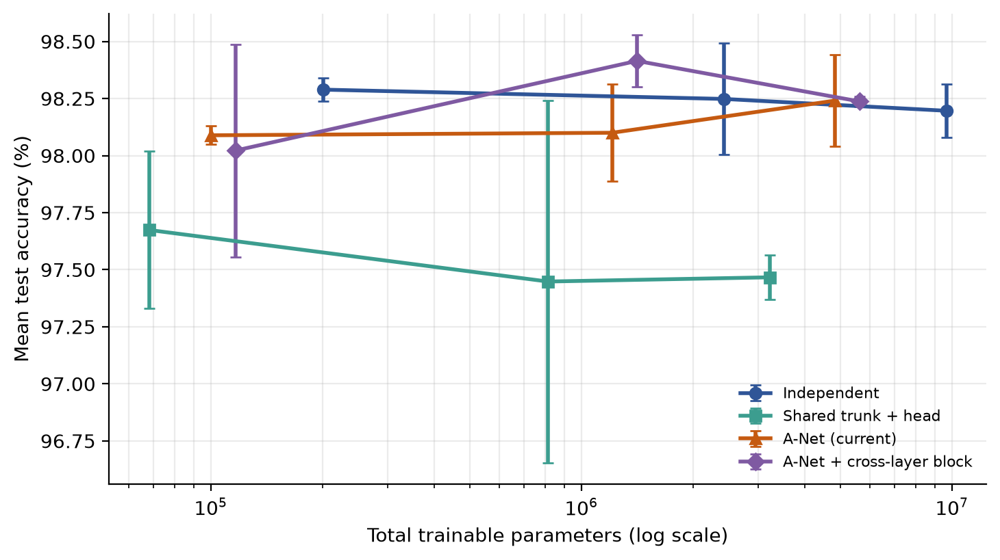
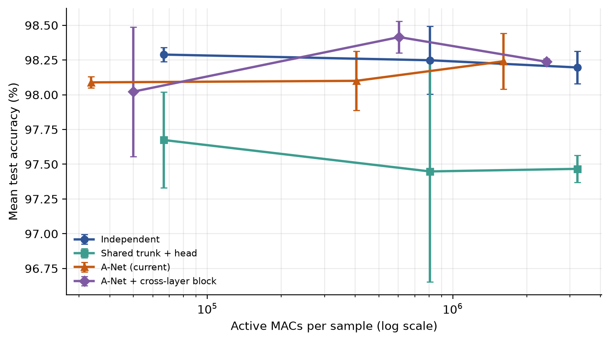
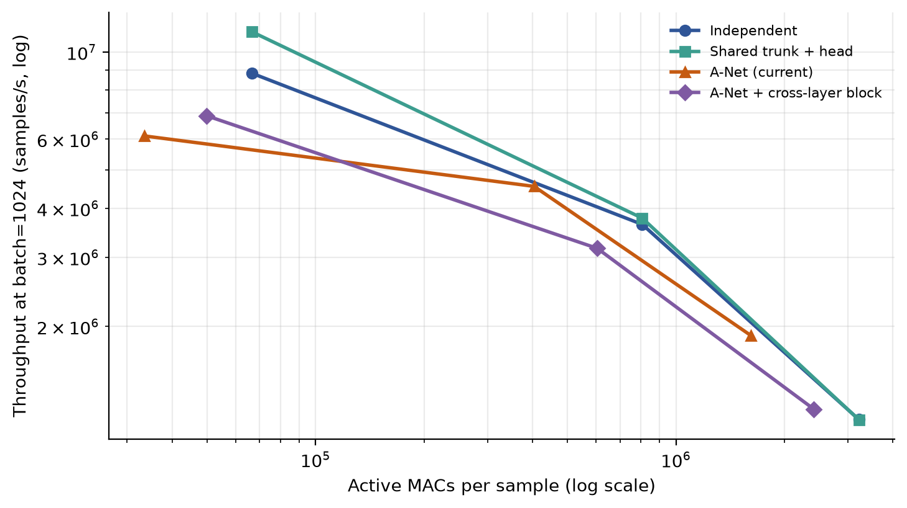
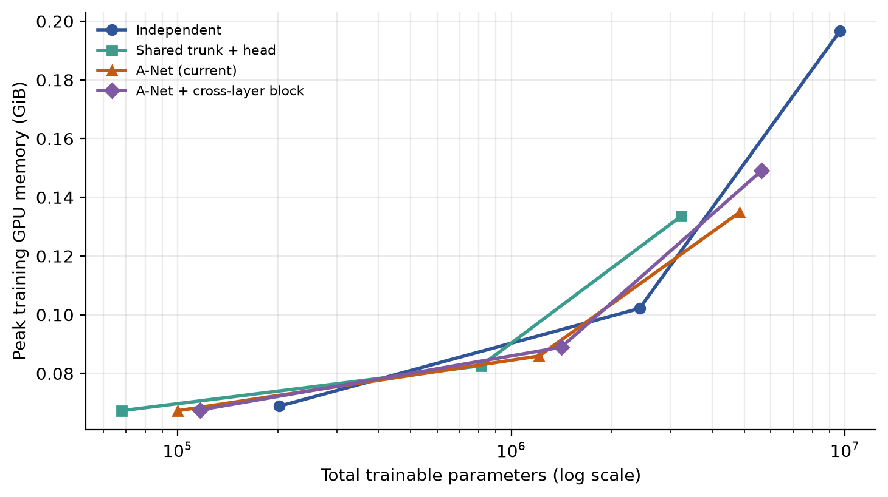

# A-Net 扩大参数规模与最终可行性报告

实验分支：experiment/scaling-and-crosslayer  
执行日期：2026-10-30  
硬件：AMD Ryzen 9 9955HX + NVIDIA GeForce RTX 5060 Laptop GPU (8 GB)  
软件：Python 3.14.6 / PyTorch 2.14.1+cu130 / CUDA 13.0 / cuDNN 9.24.0

## 0. 结论摘要

本报告区分三类主张：

| 类别 | 结论 |
|---|---|
| A. 当前已实现的共享 L1 + 任务专家 + Task-ID Top-1 路由 | **部分成立**：在受控复杂任务上接近独立基线精度，总参数/激活参数约为独立基线的一半；但 batch=1 延迟更差，存储高于共享主干，优势依赖大 batch 和规模 |
| B. 跨层参数块直接调用原型 | **尚无充分证据**：固定调用图可运行、梯度正确，但相对 A-Net 的精度收益不一致，且多消耗约 17% 总参数和 50% 激活计算 |
| C. 自动学习参数共享/路由 | **未实现**；本报告没有任何关于 C 的证据 |

一句话判断：**A-Net 的“以存储换稀疏计算”在 100k–4.8M 参数范围内是可测的，并且在中等/大规模、较大 batch 下能转换为吞吐优势；但它不是一个普遍更快的模型，也不是已经证明优于独立模型的精度方案。跨层参数块机制目前不足以支持继续作为核心方向投入。**

## 1. 仓库审查

### 1.1 初始状态

- GitHub 仓库：https://github.com/FadedDream325/A-Net-Architecture
- 分支：main，初始工作区干净，HEAD = c68e320
- 仓库原有文件：README、4 个 Python 脚本、1 个 PDF 报告、2 张架构草图、LICENSE、.gitignore
- 原始仓库**没有 tests 目录、requirements.txt、CI 或结构化原始结果文件**
- 原 README 在 GitHub 上传过程中被错误转义（大量反斜杠和 # 号），且引用了不存在的 assets/complex_accuracy.png；已在本次工作中重写
- 原始代码只实现了概念 A；没有跨层参数块调用，也没有学习式路由

### 1.2 环境与复现

| 项目 | 值 |
|---|---|
| CPU | AMD Ryzen 9 9955HX，16 核 |
| GPU | NVIDIA RTX 5060 Laptop，8 GB，sm_120，26 SM |
| 驱动 | 616.92 / CUDA UMD 13.4 |
| PyTorch | 2.14.1+cu130 |
| 磁盘可用 | 约 784 GB |
| 原始主实验复现 | 独立 99.50%，共享 99.42%，A-Net 99.37%（与仓库 PDF 一致） |
| 原始测试套件 | 不存在，无法执行“原有测试” |
| 新增测试 | 14 项，全部通过 |

原始主实验使用 CPU 单线程运行，命令为：

~~~bash
python multitask_anet_demo.py --device cpu
~~~

### 1.3 低成本预检发现的问题

预检使用 small 规模、1 个 seed、30 步：

- 第一次预检在保存 checkpoint 时失败：checkpoint_path.relative_to(ROOT) 对相对路径不成立。
- 修复为 resolve() 后，4 个模型全部完成训练与前向。
- 首次真实训练前，CUDA/cuBLAS 初始化会污染第一个模型的训练计时；已加入显式 warmup，并在正式运行前按架构/规模各执行一次真实 forward/backward。
- 正式实验无失败运行。

### 1.4 历史数字口径复核

旧 README 中的 17.0% 来自 8,770 / 51,462：分子是 h=128、expert=64 的 A-Net 单样本激活参数，分母是三个 h=128 隐层的独立模型总参数。这个比例本身是真实的，但它同时混合了“不同的专家宽度”和“不同的比较分母”，不能推广成“A-Net 普遍只激活 17% 参数”。

本轮控制实验保持同一 hidden width，并令 expert=hidden/2：A-Net 激活参数约为独立基线的 50%，而不是 17%。旧复杂任务的 95.84% 也使用了与本次不同的数据/噪声设置，不能与本次 98.09–98.24% 直接比较。旧 PDF 报告和旧脚本保留为历史结果，不作为本轮可行性结论。

### 1.5 实现状态表

| 能力 | 代码位置 | 状态 | 验证方式 |
|---|---|---|---|
| 共享 L1、任务专家、Task-ID 硬路由 | multitask_anet_demo.py / ANetHardRouting | 已实现 | 前向/反向、梯度只到选中专家、完整训练 |
| 固定调用图的跨层共享参数块 | experiments/scaling/models.py / ANetCrossLayer | 最小原型 | 单元测试 + 训练/推理消融 |
| 参数块跨任务共用同一对象 | ANetCrossLayer.shared_block | 已实现 | object identity、state_dict 键数、hook 计数 |
| 跨路径梯度累积 | CrossLayerExpert.forward(shared_block) | 已实现 | 两任务梯度与单独梯度之和比较 |
| 禁用跨层调用 | use_cross_layer=False | 已实现 | hook 计数为 0、数值等价测试 |
| 自动学习共享/路由 | 无 | 未实现 | 无实验证据 |

## 2. 实验设计

完整设计见 experiments/scaling/PROTOCOL.md。核心设置：

- 3 个 2D 二分类任务：
  - T1 Easy Sine：x2 > 0.8·sin(2x1)，1% 训练标签噪声；
  - T2 Medium Sine：x2 > 0.55·sin(3x1) + 0.28·sin(7.5x1)，2% 噪声，与 T1 同族相关；
  - T3 Hard Checker：25° 旋转棋盘，2% 噪声，与 T1/T2 不相关。
- 12,000 训练 / 3,000 测试样本每任务；测试标签干净。
- 50 epochs，batch=512，AdamW，lr=1e-3，weight decay=1e-4，FP32。
- seeds = 2026 / 2027 / 2028。
- 三档宽度：hidden=256/896/1792；A-Net 专家宽度为 hidden 的一半。
- 同一 seed 下，所有架构使用完全相同的训练/测试张量、相同初始化种子、相同优化器与 epoch。
- 数据预加载到 GPU；训练时间不含 I/O；所有架构在计时前预热。
- 36 个主实验（3 规模 × 4 架构 × 3 seeds）+ 9 个跨层禁用消融（3 规模 × 1 架构 × 3 seeds）。

### 2.1 评审限制：收益门槛不是预注册的

本轮没有在启动前冻结精度/工程收益阈值，这是一个方法论缺陷。为避免事后选择标准，报告采用以下**事后明确、探索性**判定门槛：

| 维度 | 判定门槛 | 结果 |
|---|---|---|
| 平均准确率损失 | ≤ 0.5 pp（相对独立基线） | A-Net 通过（-0.10 pp 平均） |
| 唯一参数/存储 | ≤ 独立基线的 60% | A-Net 通过（约 50%） |
| 激活 MACs | ≤ 独立基线的 60% | A-Net 通过（约 50%） |
| batch=1 延迟 | ≤ 独立基线的 1.10× | A-Net 失败（1.30–1.49×） |
| batch=1024 吞吐 | ≥ 独立基线的 1.20× | 仅 medium/large 通过 |
| 失败率 | 0 | 通过（0/36, 0/9） |
| 跨层机制净收益 | 至少 2/3 规模提升 ≥0.3 pp，且激活计算增幅 ≤10% | 失败（增益不一致，激活计算 +50%） |

这些门槛是事后用于判断的显式标准，不是预注册；结论应视为探索性证据。

## 3. 主要结果

### 3.1 复杂任务准确率（3 seeds，mean ± std）

| scale | model | total params | active params | T1 Easy | T2 Medium | T3 Hard | mean ± std |
|---|---:|---:|---:|---:|---:|---:|---:|
| small | Independent | 201,222 | 67,074 | 99.56 | 98.51 | 96.80 | **98.29 ± 0.05** |
| small | Shared trunk | 68,102 | 68,102 | 98.80 | 97.12 | 97.10 | 97.67 ± 0.34 |
| small | A-Net | 100,230 | 33,922 | 99.24 | 98.33 | 96.69 | 98.09 ± 0.04 |
| small | Cross-layer | 116,742 | 50,434 | 99.30 | 97.79 | 96.98 | 98.02 ± 0.47 |
| medium | Independent | 2,424,582 | 808,194 | 99.51 | 98.82 | 96.41 | **98.25 ± 0.25** |
| medium | Shared trunk | 811,782 | 811,782 | 98.64 | 97.73 | 95.97 | 97.45 ± 0.79 |
| medium | A-Net | 1,210,950 | 405,442 | 99.21 | 98.49 | 96.60 | 98.10 ± 0.21 |
| medium | Cross-layer | 1,412,102 | 606,594 | 99.26 | 98.81 | 97.18 | 98.41 ± 0.11 |
| large | Independent | 9,666,054 | 3,222,018 | 99.54 | 98.79 | 96.26 | 98.20 ± 0.12 |
| large | Shared trunk | 3,229,190 | 3,229,190 | 98.92 | 97.47 | 96.01 | 97.47 ± 0.10 |
| large | A-Net | 4,830,342 | 1,613,698 | 99.12 | 98.89 | 96.71 | **98.24 ± 0.20** |
| large | Cross-layer | 5,634,054 | 2,417,410 | 99.07 | 98.74 | 96.90 | 98.24 ± 0.02 |

### 3.2 关键比率

A-Net 相对独立基线：

| scale | 总参数比 | 激活参数比 | checkpoint 比 | 平均准确率差 | batch=1 延迟比 | batch=1024 吞吐比 |
|---|---:|---:|---:|---:|---:|---:|
| small | 49.8% | 50.6% | 50.1% | -0.20 pp | 1.49× | 0.69× |
| medium | 49.9% | 50.2% | 50.0% | -0.15 pp | 1.30× | 1.25× |
| large | 50.0% | 50.1% | 50.0% | +0.04 pp | 1.45× | 1.64× |

A-Net 相对共享主干：

| scale | 总参数比 | 激活参数比 | 平均准确率差 | batch=1024 吞吐比 |
|---|---:|---:|---:|---:|
| small | 1.47× | 0.50× | +0.41 pp | 0.54× |
| medium | 1.49× | 0.50× | +0.65 pp | 1.21× |
| large | 1.50× | 0.50× | +0.77 pp | 1.64× |

### 3.3 存储、训练与延迟

| scale | model | checkpoint MB | train s | peak train GB | batch1 µs | batch256 samples/s | batch1024 samples/s |
|---|---:|---:|---:|---:|---:|---:|---:|
| small | Independent | 0.81 | 4.32 | 0.069 | 90.0 | 2.08M | 8.83M |
| small | Shared | 0.28 | 4.52 | 0.067 | 92.0 | 2.35M | 11.26M |
| small | A-Net | 0.41 | 4.59 | 0.067 | 134.3 | 1.60M | 6.11M |
| medium | Independent | 9.71 | 4.33 | 0.102 | 95.0 | 2.06M | 3.64M |
| medium | Shared | 3.25 | 4.29 | 0.083 | 98.5 | 2.18M | 3.77M |
| medium | A-Net | 4.85 | 4.42 | 0.086 | 123.1 | 2.14M | 4.54M |
| large | Independent | 38.67 | 7.79 | 0.197 | 99.9 | 0.84M | 1.16M |
| large | Shared | 12.92 | 7.67 | 0.134 | 108.5 | 0.84M | 1.16M |
| large | A-Net | 19.33 | 5.31 | 0.135 | 144.7 | 1.19M | 1.90M |

所有延迟为 CUDA Event P50；训练时间不含 CUDA 初始化、数据加载和预处理；吞吐为 wall time 计算。

### 3.4 真实进程级冷启动（seed 2026）

每个配置由一个全新的 Python 进程加载 checkpoint。首模型 forward 前 CUDA 上下文已初始化，但模型 kernel 尚未预热。

| scale | model | 首次 forward | 预热后 batch1 P50 | batch1024 吞吐 | 进程总耗时 |
|---|---:|---:|---:|---:|---:|
| small | A-Net | 6.28 s | 91.7 µs | 12.73M/s | 8.3 s |
| medium | A-Net | 7.90 s | 94.9 µs | 3.94M/s | 10.4 s |
| large | A-Net | 8.29 s | 110.0 µs | 1.99M/s | 10.5 s |
| small | Independent | 7.41 s | 105.0 µs | 14.90M/s | 9.4 s |
| medium | Independent | 8.16 s | 105.9 µs | 4.02M/s | 10.2 s |
| large | Independent | 7.71 s | 102.2 µs | 1.09M/s | 9.9 s |
| small | Shared | 7.27 s | 100.2 µs | 13.45M/s | 9.3 s |
| medium | Shared | 7.48 s | 105.5 µs | 4.01M/s | 9.5 s |
| large | Shared | 7.82 s | 206.4 µs | 0.91M/s | 10.2 s |

结论：该环境下首次 forward 约 6–9 秒，进程总耗时 8–11 秒，远大于模型加载（0.01–0.03 秒）；冷启动由 GPU kernel/驱动首次加载主导，模型架构之间没有显著优势。A-Net 不是一个低冷启动方案。

### 3.5 跨层参数块消融

cross_off 使用同一个 ANetCrossLayer 类和同样的总参数，但 use_cross_layer=False；共享块参数存在但不参与前向。cross 与 cross_off 的差异因此主要反映“是否执行共享块”的差异，而不是参数存储差异。

| scale | A-Net | Cross (enabled) | Cross (disabled) | Cross active MACs vs A-Net | Cross total params vs A-Net |
|---|---:|---:|---:|---:|---:|
| small | 98.09 ± 0.04 | 98.02 ± 0.47 | 98.03 ± 0.11 | 1.49× | 1.16× |
| medium | 98.10 ± 0.21 | 98.41 ± 0.11 | 98.02 ± 0.30 | 1.50× | 1.17× |
| large | 98.24 ± 0.20 | 98.24 ± 0.02 | 97.86 ± 0.37 | 1.50× | 1.17× |

观察：

- small：启用/禁用跨层块没有差异（98.02 vs 98.03）。
- medium：启用块比禁用高 0.39 pp，但比 A-Net 高 0.31 pp；同时激活 MACs 比 A-Net 高 50%。
- large：启用块比禁用高 0.37 pp，但和 A-Net 完全相同（98.24）；激活 MACs 比 A-Net 高 50%。
- 因此存在“块执行可能带来一些容量收益”的初步迹象，但收益不一致，且没有证明它在等计算预算下优于 A-Net。跨层参数块本身不应被视为已验证的普遍增益机制。

### 3.6 图表

## 4. 逐项回答可行性问题

### Q1. 是否降低唯一参数量与模型存储需求？

**相对独立基线：是。** 三个规模下 A-Net 的总参数和 checkpoint 都约为独立基线的 50%。  
**相对共享主干：否。** A-Net 的总参数约为共享主干的 1.47–1.50 倍。

因此结论必须限定为“相对于独立模型减半存储”，不能表述为“普遍降低存储”。

### Q2. 是否降低实际计算量？

**是。** A-Net 的单样本激活参数和 MACs 约为独立基线的 50%，也约为共享主干的 50%。分析公式已用 torch.utils.flop_counter 在四个架构上验证一致。路由为整数索引，不产生可测张量 MACs。

### Q3. 是否在真实硬件上降低推理延迟或提高吞吐？

**部分成立。**  
- batch=1：A-Net 延迟是独立基线的 1.30–1.49 倍，**没有降低**。
- batch=1024：A-Net 吞吐是独立基线的 0.69×（small）/1.25×（medium）/1.64×（large）。  
  即只有中等/大规模时吞吐占优，small 规模因路由和多次小 kernel 调用反而更慢。
- 训练：large 规模 A-Net 训练时间为独立基线的 0.68×；small/medium 基本持平。

### Q4. 精度损失是否在可接受范围内？

按报告事后定义的 0.5 pp 门槛：**是**。平均差 -0.20/-0.15/+0.04 pp，均值约 -0.10 pp。  
但这依赖任务集合，且没有进行正式显著性检验；T1 上 A-Net 始终低约 0.3–0.4 pp，T3 上部分规模更高。

### Q5. 优势是否随参数规模增加而保留？

**部分保留。**
- 参数/计算/存储比例在所有规模稳定在约 50%。
- 精度差从 -0.20 pp 缩小到约 0 pp。
- 吞吐优势只在较大规模出现（0.69→1.25→1.64×）。
- batch=1 延迟劣势没有随规模消失。

### Q6. 跨层参数块调用本身是否带来可测量的增益？

**尚无充分证据。**
- 启用/禁用对比在 medium/large 有 +0.39/+0.37 pp，small 为 0；但 cross 相对 A-Net 只有 +0.31/0.00/-0.07 pp。
- 它稳定增加约 17% 总参数、50% 激活 MACs，并且没有等计算预算的独立控制组。
- 因此不能把跨层调用认定为工程收益；最多是继续研究的候选机制。

### Q7. 结果是否依赖特定任务、随机种子、硬件或测量方式？

**是。**
- 只有 3 个合成 2D 任务，测试标签干净，训练噪声 1–2%。
- 只有 3 个种子；没有置信区间或显著性检验。
- 只有一张 RTX 5060 Laptop、一个 PyTorch/CUDA 构建；桌面应用共享 GPU，延迟有波动。
- 延迟和吞吐使用不同工具（CUDA Event vs wall time），冷启动单独测。
- 没有真实图像/语言/表格任务。

### Q8. 当前收益是否足以支持继续投入？

**有条件支持继续研究 A，不支持把 B 作为核心。**
- A-Net 在中等/大规模、大 batch 下确实提供了“约一半参数/计算，接近独立基线精度”的可行折中；这值得在真实数据、静态图和更大规模上继续验证。
- 但 batch=1 更慢、存储高于共享主干，当前不能宣称全面高效。
- 跨层参数块 B 的固定原型没有展示稳定净收益，应先做严格的等参数/等计算控制实验。
- C 尚未实现，不能纳入结论。

## 5. 最终判断

| 判断 | 内容 |
|---|---|
| 已验证可行 | A-Net 在 100k/1.2M/4.8M 三档、3 seeds、受控任务上无失败；总参数/激活 MACs 约为独立基线 50%；medium/large 的 batch=1024 吞吐高于独立/共享；large 训练时间和峰值显存更低 |
| 部分成立 | 精度接近独立基线、大 batch 吞吐占优；但 batch=1 延迟更差，存储高于共享主干，优势依赖规模和 batch |
| 尚无充分证据 | 跨层参数块调用的稳定净收益；A-Net 优势在真实任务/更大规模上的可迁移性 |
| 实验不支持 | “A-Net 普遍更快/普遍更省存储”；“跨层机制已验证”；“自动学习路由已经实现” |

## 6. 限制与未解决问题

1. 任务仍然全部是合成 2D 数据；T1/T2 的相关性、T3 的难度都是人工设计。
2. 只有 3 个种子，且没有预注册的精度/收益阈值；事后门槛只能作为探索性判断。
3. 只有一张 GPU；没有多卡、并发服务、CUDA Graph、TensorRT、ONNX。
4. 没有动态路由/学习路由；Task ID 是已知输入，路由是确定性索引。
5. 训练时间排除了数据加载，但真实训练会有 I/O 和主机到设备传输。
6. 冷启动只测了一个 seed；冷启动的 6–9 秒是当前 Windows/PyTorch 环境的观测，不应外推到其他栈。
7. 没有等参数/等计算控制组来分离跨层块的容量效应与调用机制。

## 7. 复现与产物

原始结果目录：

- experiments/scaling/results/scaling_v1/raw_runs.jsonl
- experiments/scaling/results/scaling_v1/summary.csv
- experiments/scaling/results/scaling_v1/summary.md
- experiments/scaling/results/scaling_v1/cold_start/cold_start_summary.csv
- experiments/scaling/results/scaling_cross_ablation/raw_runs.jsonl
- experiments/scaling/results/scaling_cross_ablation/summary.md

运行命令：

~~~bash
pip install -r requirements.txt
python -m pytest -q -p no:cacheprovider tests

python -m experiments.scaling.run_scaling \
  --scales small medium large \
  --models independent shared anet cross \
  --seeds 2026 2027 2028 --epochs 50 \
  --out-dir experiments/scaling/results/scaling_v1 --resume

python -m experiments.scaling.run_scaling \
  --scales small medium large --models cross_off \
  --seeds 2026 2027 2028 --epochs 50 \
  --out-dir experiments/scaling/results/scaling_cross_ablation

python -m experiments.scaling.analyze_results \
  --results-dir experiments/scaling/results/scaling_v1
python -m experiments.scaling.benchmark_cold_starts \
  --results-dir experiments/scaling/results/scaling_v1 --seed 2026
~~~

后续优先级：

1. 在真实表格/图像任务上重复 100k–5M 三档实验，至少 5 seeds。
2. 对 A-Net 做等参数/等激活计算的共享主干控制，区分“容量”与“路由结构”。
3. 在静态图/TensorRT/ONNX 上测 batch=1 与 batch=1024，验证延迟结论是否来自 PyTorch eager 调度。
4. 若要继续 B，先实现等参数、等计算的 per-task block 对照，再决定是否值得开发学习式跨层调用。
5. 将训练失败率、路由分布和数值异常纳入 CI 回归。
